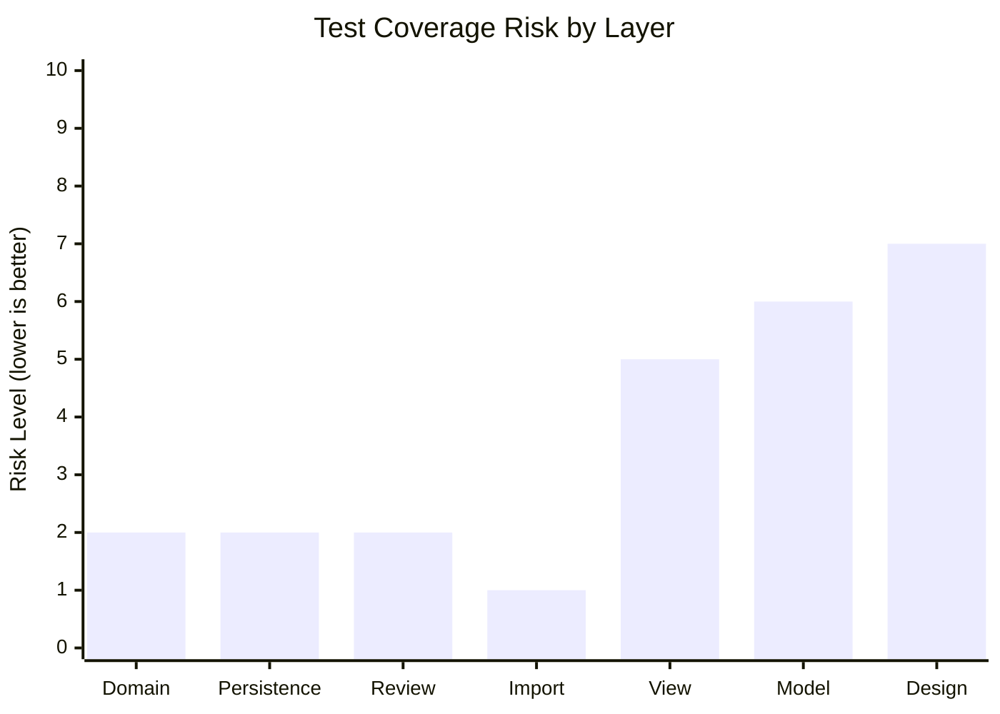

# Test Quality & Coverage Audit

**Date**: 2026-11-17  
**Scope**: Entire test suite (`test/`, `integration_test/`)  
**Suite size**: ~3,044 tests (2,176 `test()` + 868 `testWidgets()`) across 224 test files

---

## 1. Coverage Gap Analysis

### 1.1 Summary

| Layer | Source files | With direct test | Without direct test | Coverage % |
|---|---|---|---|---|
| **domain/** | 25 | 7 | 18 | 28% |
| **persistence/** | 13 | 9 | 4 | 69% |
| **review/** | 4 | 2 | 2 | 50% |
| **import/** | 5 | 5 | 0 | 100% |
| **view/** | 73 | 23 | 50 | 32% |
| **model/** | 85 | 32 | 53 | 38% |
| **design/** | 18 | 3 | 15 | 17% |
| **widgets/** | 30 | 10 | 20 | 33% |
| **Other** (db, network, utils, etc.) | 83 | 38 | 45 | 46% |
| **TOTAL** | 336 | 129 | 207 | 38% |

> [!IMPORTANT]
> The 38% direct-file coverage is misleading in isolation. Many "untested" domain files
> are data classes (chapter.dart, ids.dart, study.dart, review_result.dart) exercised
> heavily by the review/persistence/import tests. The real gaps are in the *behavioral*
> files listed below.

### 1.2 Critical Domain Files Without Direct Test

These domain files contain behavioral logic and lack a matching `_test.dart`:

| Source file | Risk | Coverage by other tests |
|---|---|---|
| [review_session.dart](file:///home/mohamed/Desktop/Github/ChessSRS/lib/src/domain/review/review_session.dart) (1847 LOC) | **Critical** | Heavily tested via `test/review/review_session_test.dart` (2427 LOC). **This is covered.** |
| [review_engine.dart](file:///home/mohamed/Desktop/Github/ChessSRS/lib/src/domain/review/review_engine.dart) (84 LOC) | **High** | Tested via `test/review/review_engine_test.dart` (2557 LOC). **Covered.** |
| [review_scope.dart](file:///home/mohamed/Desktop/Github/ChessSRS/lib/src/domain/review/review_scope.dart) | Medium | Tested via `test/domain/review_scope_test.dart`. **Covered.** |
| [review_continuity.dart](file:///home/mohamed/Desktop/Github/ChessSRS/lib/src/domain/review/review_continuity.dart) (16 LOC) | Low | Tested via `test/review/review_continuity_test.dart` (1275 LOC). **Covered.** |
| [due_status.dart](file:///home/mohamed/Desktop/Github/ChessSRS/lib/src/domain/review/due_status.dart) | Low | Tested via `test/domain/due_status_test.dart`. **Covered.** |
| [transpose_scope.dart](file:///home/mohamed/Desktop/Github/ChessSRS/lib/src/domain/review/transpose_scope.dart) | Medium | Tested via `test/review/review_transposition_test.dart`. **Covered.** |
| [review_order.dart](file:///home/mohamed/Desktop/Github/ChessSRS/lib/src/domain/review/review_order.dart) | Medium | Tested via `test/review/review_order_test.dart`. **Covered.** |

**Verdict**: Domain behavioral logic is well covered despite the naming mismatch. The test
files use feature-oriented naming rather than 1:1 source file matching.

### 1.3 Genuinely Uncovered Source Files (High Risk)

| Source file | LOC | Why it matters |
|---|---|---|
| [fresh_introduction_order.dart](file:///home/mohamed/Desktop/Github/ChessSRS/lib/src/review/fresh_introduction_order.dart) | — | Controls INV-068 fresh position ordering. No dedicated test, but exercised by `review_fresh_spread_test.dart`. Partial coverage. |
| [srs_settings_providers.dart](file:///home/mohamed/Desktop/Github/ChessSRS/lib/src/review/srs_settings_providers.dart) | — | Settings providers for SRS config. No direct test. |
| [node_index.dart](file:///home/mohamed/Desktop/Github/ChessSRS/lib/src/persistence/node_index.dart) | — | Performance-critical node index. Tested via `review_node_index_test.dart` and `session_node_index_load_test.dart`. |
| [srs_schema.dart](file:///home/mohamed/Desktop/Github/ChessSRS/lib/src/persistence/srs_schema.dart) | — | Schema definition. Indirectly tested by `srs_schema_indexes_test.dart` and all persistence tests. |
| [study_repository.dart](file:///home/mohamed/Desktop/Github/ChessSRS/lib/src/persistence/study_repository.dart) | — | Interface. Tested via implementation tests. |

### 1.4 View Layer Gaps

50 view source files lack direct tests. Notable gaps:

| Source file | Risk | Reason |
|---|---|---|
| [review_scope_drawer.dart](file:///home/mohamed/Desktop/Github/ChessSRS/lib/src/view/review/review_scope_drawer.dart) | **High** | Core review UI — user's scope selection. Has `review_scope_drawer_test.dart` ✓ (naming match exists under view/review/) |
| [account_menu.dart](file:///home/mohamed/Desktop/Github/ChessSRS/lib/src/view/account/account_menu.dart) | Medium | Sign-in/out entry point. No test. |
| [study_gamebook.dart](file:///home/mohamed/Desktop/Github/ChessSRS/lib/src/view/study/study_gamebook.dart) | Low | Inherited Lichess feature. |
| Most view/game/, view/explorer/, view/account/ files | Low | Inherited Lichess UI, not core SRS. |

---

## 2. Test Quality Issues

### 2.1 Weak Assertions (isNotNull without further checking)

30 occurrences of `expect(x, isNotNull)` without subsequent assertions on the value.
Most are acceptable guard-style assertions (gating further test logic), but some are
genuinely weak:

| File | Line | Issue |
|---|---|---|
| [account_repository_test.dart](file:///home/mohamed/Desktop/Github/ChessSRS/test/model/account/account_repository_test.dart#L107) | 107 | `expect(user, isNotNull)` — should assert specific user properties |
| [position_evaluator_test.dart](file:///home/mohamed/Desktop/Github/ChessSRS/test/model/engine/position_evaluator_test.dart#L170) | 170, 229, 552, 745, 903, 919, 932 | Multiple `expect(stream, isNotNull)` — these are gate assertions before subscribing; acceptable but could use a typed check |

**Severity**: Low. These are predominantly guard-checks before stronger assertions follow.

### 2.2 No Always-True Assertions Found

`rg 'expect(true' test/` returned **zero** results. The suite has no `expect(true, isTrue)` patterns.

### 2.3 Flaky Test Patterns

#### DateTime.now() in tests
20 occurrences of `DateTime.now()` in test files. Analysis:

| Pattern | Count | Risk |
|---|---|---|
| `FixedClock(DateTime.now().toUtc())` in perf tests | 4 | **Low** — anchored immediately to a fixed clock |
| `DateTime.now()` in `test_helpers.dart` for poll timeouts | 3 | **None** — polling infrastructure, not assertions |
| `DateTime.now()` in `fake_auth_repository.dart` for fixture data | 2 | **Low** — seed data, not time-sensitive assertions |
| `DateTime.now()` in `offline_computer_game_screen_test.dart` for `createdAt` | 4 | **Low** — fixture data timestamps |
| `DateTime.now().toUtc().toIso8601String()` in migration tests | 3 | **Medium** — migration tests use wall-clock time for fixture rows; could break near midnight |
| `DateTime.now().subtract(Duration(hours: 2))` in user_test.dart | 1 | **Low** — relative time for "last seen" display |

**Verdict**: Domain scheduling/review tests consistently use `FixedClock` per INV-041.
The wall-clock uses are in fixture construction, not assertions.

#### Sleep/Delay patterns
Only `Future.delayed` appears in test infrastructure (fake websocket factory) and
one `rate_limit_test.dart` comment. No real `sleep()` calls found in the suite — the
`practice_analyser_test.dart` comment explicitly documents why flake-mode sleep was
removed in favour of a fake clock.

### 2.4 Mock Usage

Very minimal mock framework usage. Only 6 `verify()` calls in the entire suite
(game_history_test, create_study_chapter_bottom_sheet_test, offline_computer_game_screen_test).
The suite strongly favours:

- **In-memory databases** (sqflite_ffi) over mocked repositories
- **Fake implementations** (FakeEngine, FakeSoundService, FakeConnectivity) over mocks
- **Real domain objects** over mocked domain objects

> [!TIP]
> This is a quality strength. Testing against real in-memory databases catches issues
> that mocked repositories would miss (SQL query bugs, schema constraints, etc.).

### 2.5 Skipped Tests

10 skipped tests, all in [screenshot_capture_test.dart](file:///home/mohamed/Desktop/Github/ChessSRS/test/view/screenshot_capture_test.dart)
with `skip: !_enabled`. These are opt-in screenshot capture tests, not abandoned work.

### 2.6 Error Path Testing

117 `throwsA`/`throwsException` etc. assertions — healthy error path coverage,
especially in:
- PGN import (malformed input)
- Auth flows (401, network errors)
- Bulk import (partial failures, INV-011)
- Schema migration (crash recovery)

---

## 3. SPEC Invariant Coverage

### 3.1 All INVs are Cited

Every INV defined in SPEC.md (45 invariants) has at least one test citation.
The `spec_trace_check.py` gate (`G05`) enforces this automatically.

| INV | SPEC Title | Test Files | Depth |
|---|---|---|---|
| INV-001 | Acknowledged answer survives restart | database_config_test, srs_upgrade_test, sqlite_study_repository_test, review_controller_test | ✅ Deep |
| INV-002 | Review writes are incremental | review_service_test, sqlite_study_repository_test, library_rotation_test | ✅ Deep |
| INV-003 | Re-importing identical material | review_controller_test, sqlite_study_repository_test | ✅ Deep |
| INV-004 | Deleting study never removes shared memory | sqlite_study_repository_test | ✅ Adequate |
| INV-005 | Schema upgrade without data loss | fen_key_backfill_migration_test, fen_key_backfill_crash_test, srs_upgrade_test, opening_name_repair_migration_test | ✅ Deep |
| INV-006 | Auth secrets never reach durable logs | app_log_redaction_test, auth_repository_test | ✅ Adequate |
| INV-007 | Startup session check | startup_token_check_test, auth_repository_test, auth_identity_fencing_test | ✅ Deep |
| INV-008 | Only configured host is first-party | app_links_service_test | ✅ Deep |
| INV-010 | Variations preserved as branches | entities_test, review_engine_test | ✅ Adequate |
| INV-011 | Malformed input quarantined | review_controller_test (5+ tests for bulk import failures) | ✅ Deep |
| INV-012 | Custom starting positions | review_engine_test | ✅ Adequate |
| INV-013 | Each chapter trains from its own side | review_controller_test, review_side_scope_test, canonical_state_id_backfill_test | ✅ Deep |
| INV-014 | Export then re-import preserves identity | node_test (9 citations) | ✅ Deep |
| INV-015 | Position identity = normalized 4-field FEN | review_engine_test | ✅ Adequate |
| INV-016 | Transpositions share one memory | review_service_test, sqlite_study_repository_test, review_engine_test | ✅ Deep |
| INV-017 | Accepted-reply sets distinguish memories | graph_aware_review_coordinator_test, review_engine_test | ✅ Adequate |
| INV-020 | Correctness = matching repertoire | review_controller_test, review_engine_test | ✅ Deep |
| INV-021 | A lapse is recoverable in place | review_continuity_test, review_engine_test, review_controller_test | ✅ Deep |
| INV-022 | Traversal is never exclusion | review_continuity_test (13+ dedicated tests), review_engine_test | ✅ **Excellent** |
| INV-023 | Practice mode writes nothing | review_controller_test, review_engine_test | ✅ Adequate |
| INV-024 | Scheduling is a pure function | scheduler_test, chess_fsrs_scheduler_test, scheduler_properties_test | ✅ Deep |
| INV-025 | Success grows interval, lapses restart | scheduler_lapse_bound_test, review_engine_test, scheduler_test | ✅ Deep |
| INV-026 | Intervals stay within bounds | chess_fsrs_scheduler_test, scheduler_test, scheduler_properties_test, review_state_test | ✅ Deep |
| INV-027 | Lapse contagion bounded | graph_aware_review_coordinator_test | ✅ Adequate |
| INV-028 | Traversal credit micro/throttled | graph_aware_review_coordinator_test, review_engine_test, sqlite_study_repository_test | ✅ Adequate |
| INV-029 | Siblings couple only on genuine confusion | graph_aware_review_coordinator_test | ✅ Adequate |
| INV-030 | Scopes filter exactly | review_service_test, review_controller_test, review_screen_test (30+ citations total) | ✅ **Excellent** |
| INV-031 | Daily quota counts positions | review_controller_test, review_engine_test, review_service_test, review_continuity_test | ✅ **Excellent** |
| INV-032 | Stale sessions never take over | answer_publication_fencing_test, review_controller_test, review_service_test | ✅ Deep |
| INV-033 | Castling notations equivalent | entities_test, review_engine_test | ✅ Adequate |
| INV-040 | Domain layer is pure Dart | domain_boundary_test (import-scanning gate) | ✅ Gate |
| INV-041 | Scheduling takes time only through Clock | domain_boundary_test (wall-clock scanning gate), scheduler_test | ✅ Gate |
| INV-042 | Domain performs no I/O | domain_boundary_test (I/O scanning gate) | ✅ Gate |
| INV-050 | Graded move settles < 16ms | move_latency_test, review_node_index_test, review_controller_test | ✅ Deep |
| INV-051 | Bulk lookups stay bounded | review_service_test, sqlite_study_repository_test (7+ chunking tests) | ✅ **Excellent** |
| INV-060 | Every verdict announced to screen readers | review_screen_test, offline_computer_game_screen_test | ✅ Adequate |
| INV-061 | Feedback stays readable in both themes | srs_colors_contrast_test, board_squares_test, design_primitives_test | ✅ Deep |
| INV-062 | Interactive targets stay tappable | design_primitives_test, game_layout_test (12+ viewport tests), practice_exit_test, top_bar_narrow_test | ✅ **Excellent** |
| INV-063 | Comment shapes never leak during recall | review_screen_test, offline_computer_game_screen_test, srs_settings_screen_test | ✅ Deep |
| INV-064 | Every socket handshake carries session sri | socket_test | ✅ Adequate |
| INV-065 | Out-of-line repertoire move accepted | review_transposition_test (9+ tests), review_node_index_test, session_node_index_load_test, review_service_test | ✅ **Excellent** |
| INV-066 | By-line queue order | review_order_test, review_continuity_test, review_fresh_spread_test | ✅ Deep |
| INV-067 | Opening hub is a family name | opening_name_repair_migration_test | ✅ Adequate |
| INV-068 | Due only once presented | review_service_test, review_engine_test, review_fresh_spread_test, review_controller_test, review_continuity_test, review_state_test, library_rotation_test | ✅ **Excellent** |
| INV-069 | Upgrade leaves no orphaned review-state | orphaned_review_state_sweep_test | ✅ Adequate |

### 3.2 INV Coverage Strength Assessment

- **Excellent** (8): INV-022, INV-030, INV-031, INV-051, INV-062, INV-065, INV-066, INV-068
- **Deep** (19): INV-001–005, INV-007, INV-011, INV-013–014, INV-016, INV-020–021, INV-024–026, INV-032, INV-050, INV-061, INV-063
- **Adequate** (15): INV-006, INV-008, INV-010, INV-012, INV-015, INV-017, INV-023, INV-027–029, INV-033, INV-060, INV-064, INV-067, INV-069
- **Gate** (3): INV-040, INV-041, INV-042

No invariant is untested. The gate script `spec_trace_check.py` enforces citation coverage.

---

## 4. Property-Based Testing Opportunities

### 4.1 High Value

| Domain | Property | Rationale |
|---|---|---|
| **SRS Scheduling** (scheduler.dart, chess_fsrs_scheduler.dart) | `∀ state, event, time: schedule(state, event, time).interval ∈ [minInterval, maxInterval]` | INV-026 tested with fixed examples. A property test with random states/events would catch interval-cap escapes that specific examples miss. `scheduler_properties_test.dart` already does pseudo-random testing — extend its seed range. |
| **SRS Scheduling** | `∀ state, event, time: schedule(state, event, time)` is deterministic (same input → same output) | INV-024. Already tested with one seed set. |
| **FEN Normalization** | `∀ fen: normalize(parse(fen).fen) == normalize(fen)` | INV-015. Idempotency of FEN normalization. Edge cases: Chess960 castling, en-passant squares, fullmove counters. |
| **PGN Round-Trip** | `∀ tree: parse(export(tree)) ≅ tree` | INV-014. Already tested in node_test.dart with specific cases. Property-based would fuzz tree shapes (deep, wide, with NAGs, comments, RAVs). |
| **Review Session Idempotency** | `∀ decisions, seed: session.dueSet ⊆ scope.allDecisions` | No session should produce a prompt outside its scope. |

### 4.2 Medium Value

| Domain | Property |
|---|---|
| **Opening Name** | `∀ pgn_headers: openingName(headers)` returns a family name, not a specific variation title (INV-067) |
| **Fast Date Parser** | `∀ iso8601_string: fastParse(s) == DateTime.parse(s)` — correctness against standard library |
| **JSON Adapters** | `∀ model: fromJson(toJson(model)) == model` — round-trip for all serializable domain models |
| **Lapse Contagion** | `∀ graph, lapse_node: contagion_set(lapse_node).length ≤ contagionBound ∧ unlearned ∉ contagion_set` (INV-027) |

### 4.3 Existing Pseudo-Random Tests

[scheduler_properties_test.dart](file:///home/mohamed/Desktop/Github/ChessSRS/test/domain/scheduler_properties_test.dart)
already uses seed-based random exploration for scheduler properties. This is an excellent
pattern to extend to other domains.

---

## 5. Integration Test Gaps

### 5.1 Current State

One integration test: [app_smoke_test.dart](file:///home/mohamed/Desktop/Github/ChessSRS/integration_test/app_smoke_test.dart)

It covers:
- ✅ Import a PGN and answer one review prompt (Journey 1 + Journey 2 partial)
- ✅ Verifies the answer reaches the real SQLite database
- ✅ Uses real rendering, real board taps, real persistence

### 5.2 Missing Journey Coverage

| Journey | PRODUCT.md | Integration Test | Gap |
|---|---|---|---|
| **Journey 1**: Daily Review (full session) | §3.1 | Partial (one move only) | Multi-move session, lapse+reguess, traversal, session completion |
| **Journey 2**: First Launch & PGN Import | §3.2 | Partial (import only) | Zero-state welcome screen, file picker flow |
| **Journey 3**: Constrained Scope | §3.3 | ❌ **Not covered** | Opening hub selection, scope drawer, filtered review |
| **Journey 4**: Pre-Match Rehearsal | §3.4 | ❌ **Not covered** | Practice mode toggle, non-destructive rehearsal |
| **Journey 5**: Deck Suspension | §3.5 | ❌ **Not covered** | Study active/inactive toggle, filtered queue |

> [!NOTE]
> The widget test suite covers many of these flows at the widget level (review_screen_test,
> review_scope_drawer_test, srs_settings_screen_test). The integration test gap is
> specifically about full-stack, real-database, real-rendering coverage.

---

## 6. Test Infrastructure Quality

### 6.1 Test Container ([test_container.dart](file:///home/mohamed/Desktop/Github/ChessSRS/test/test_container.dart), 136 LOC)

**Strengths:**
- Clean provider overrides for all external dependencies
- In-memory SQLite via sqflite_ffi
- Proper teardown (db.close, container.dispose, binding.reset)
- Uses production retry policy for realistic behavior
- Well-documented with comments explaining each override

**Issues:** None found. This is well-designed infrastructure.

### 6.2 Test Provider Scope ([test_provider_scope.dart](file:///home/mohamed/Desktop/Github/ChessSRS/test/test_provider_scope.dart), 431 LOC)

**Strengths:**
- Layout overflow detection (fails on `RenderFlex` overflows instead of swallowing them)
- Proper font loading for accurate text measurement
- SRS theme application for realistic rendering
- Both online and offline mock clients available

**Issues:** None found. The overflow handler is particularly well-designed.

### 6.3 Test Helpers ([test_helpers.dart](file:///home/mohamed/Desktop/Github/ChessSRS/test/test_helpers.dart), 306 LOC)

**Strengths:**
- Multi-surface size testing (15 device sizes including foldables)
- Cross-platform variant (Android + iOS)
- Board state extraction utilities
- Polling utilities with timeouts

**Issues:**
- Polling helpers use `DateTime.now()` for deadlines, which is acceptable for infrastructure
  but could theoretically cause issues under extreme CI load. Low risk.

### 6.4 Shared Test Fixtures

| File | Purpose | Quality |
|---|---|---|
| `test/example_data.dart` | Shared PGN and study fixtures | ✅ Well-structured |
| `test/review/review_invariant_oracle.dart` | Property oracle for review invariants | ✅ Excellent — reusable invariant checker |
| `test/review/gated_study_repository.dart` | Concurrency testing fixture | ✅ Purpose-built for race condition tests |
| `test/persistence/faulty_database.dart` | Crash/corruption testing | ✅ Purpose-built for INV-005 crash recovery |

---

## 7. Mutation Testing Readiness

### 7.1 Current State (from [AUTONOMOUS_MUTANTS.md](file:///home/mohamed/Desktop/Github/ChessSRS/docs/AUTONOMOUS_MUTANTS.md))

| Disposition | Count |
|---|---|
| **OPEN** (surviving mutants) | 147 |
| **KILLED-BY** (test-killed) | 120 |
| **EQUIVALENT** (behavior-identical) | 28 |
| **WONTFIX** | 1 |
| **NOISE** | 1 |

**Kill rate**: 120 / (120 + 147) = **45%** (excluding equivalents)  
**Adjusted kill rate**: 120 / (120 + 147 - 28) = **50%** (excluding equivalents)

### 7.2 Surviving Mutant Hotspots

The largest clusters of surviving mutants are in:
- `app_links_service.dart` — boolean flag inversions (animated, allowBrowserFallback, rootNavigator)
- `auth_controller.dart` — logical operator swaps (||→&&) in race-condition guards
- `pgn_offload.dart` — boundary condition tightening

### 7.3 Mutation Testing Gaps

The ledger covers only a subset of source files. No mutation testing has been recorded for:
- `review_session.dart` (1847 LOC) — the most complex domain file
- `review_service.dart` (1183 LOC) — the main review orchestration layer
- `review_controller.dart` (2213 LOC) — the main UI-facing controller
- `sqlite_study_repository.dart` (1533 LOC) — the persistence layer
- `pgn_importer.dart` (810 LOC) — the import pipeline

> [!WARNING]
> These are the highest-value mutation testing targets. Mutations in scheduling logic,
> boundary conditions, and SQL query construction would have the greatest risk of
> undetected behavioral changes.

---

## 8. Proposed New Tests (Priority Ranked)

### 8.1 Critical (High risk reduction)

| # | Proposal | INV | Rationale |
|---|---|---|---|
| 1 | **Property-based scheduler test**: random states × events × times, assert INV-026 cap | INV-024/025/026 | Extend `scheduler_properties_test.dart` with wider parameter space |
| 2 | **FEN normalization round-trip property test** | INV-015 | Catch edge cases in custom starting positions, Chess960 castling |
| 3 | **PGN round-trip property test**: generate random trees, export, re-import, assert structure preserved | INV-014 | Fuzz tree shapes (deep nesting, many NAGs, Unicode comments) |
| 4 | **Mutation test campaign**: `review_session.dart` | INV-022/025/028/031 | 1847 LOC of untested-for-mutations logic; highest risk |
| 5 | **Mutation test campaign**: `sqlite_study_repository.dart` | INV-001/002/004/051 | SQL boundary conditions, batch loop boundaries |

### 8.2 High (Moderate risk reduction)

| # | Proposal | INV | Rationale |
|---|---|---|---|
| 6 | **Integration test**: constrained-scope journey (Journey 3) | INV-030 | No real-device test of scope filtering with real DB |
| 7 | **Integration test**: practice mode journey (Journey 4) | INV-023 | Verify no DB writes in practice mode on real stack |
| 8 | **Fresh introduction ordering edge cases** | INV-068 | Test boundary: exactly at daily cap, 0 cap, cap with transpositions |
| 9 | **Lapse contagion property test** | INV-027 | Random graph shapes, verify bounded propagation |
| 10 | **Fast date parser property test** | — | `∀ valid_iso8601: fastParse == DateTime.parse` — catch parsing divergence |

### 8.3 Medium (Nice to have)

| # | Proposal | Rationale |
|---|---|---|
| 11 | JSON adapter round-trip for all Freezed models | Catch serialization edge cases |
| 12 | Opening name property test (INV-067) | Fuzz PGN headers, assert family names |
| 13 | Node index correctness under concurrent writes | Concurrency stress test for the in-memory index |
| 14 | Schema migration test with maximally-corrupted pre-state | Stress INV-005 crash recovery |
| 15 | Widget test: account_menu.dart sign-in/out flows | Currently uncovered view file |

---

## 9. Overall Assessment

### Strengths
1. **Excellent SPEC traceability**: All 45 invariants are cited in tests with automated enforcement
2. **Deep review/domain testing**: 22,000+ LOC of review/domain tests covering the core SRS loop
3. **Real database testing**: In-memory SQLite instead of mocked repositories catches real SQL bugs
4. **Minimal mocking**: The suite tests real behavior, not mock behavior
5. **Gate automation**: domain_boundary_test, spec_trace_check.py, layout overflow handler
6. **Mutation testing started**: 120 killed mutants across auth, links, PGN offload
7. **Performance tests**: Dedicated perf/ test directory with attribution and ceiling tests
8. **Crash recovery tests**: fen_key_backfill_crash_test, faulty_database fixture

### Weaknesses
1. **Integration test gap**: Only 1 smoke test; 3 of 5 user journeys have no full-stack test
2. **Mutation testing incomplete**: No mutation campaigns for the 4 largest behavioral files
3. **Property-based testing nascent**: Only scheduler_properties_test uses random exploration
4. **View layer coverage**: Many view files untested (though most are inherited Lichess UI)
5. **Migration tests use DateTime.now()**: 3 occurrences could theoretically flake near midnight

### Risk Summary

The core SRS pipeline (domain → persistence → review → import) is **well tested**.
The highest-risk gaps are in the view layer and inherited Lichess model code, which
is lower priority for a local-first SRS app.
