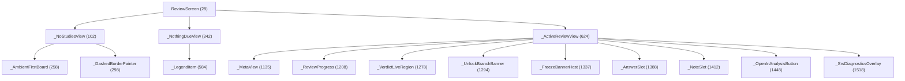
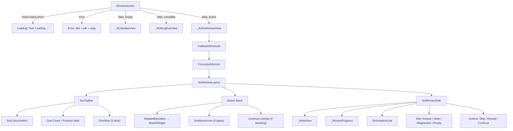

# UX & Design Systems Audit

> Audit date: 2026-11-17  
> Auditor: ux-auditor (mega-review swarm)  
> Scope: `lib/src/design/`, `lib/src/view/`, `lib/src/widgets/`, `design/docs/`

---

## Executive Summary

The ChessSRS design system ("Diagram") is **substantially implemented and
coherent**. The token layer, primitives, review layout and board background form
a solid, Material-free foundation. The main review flow uses `SrsTheme.of`
consistently. This audit found **no critical blockers**, but identifies spec
divergences, widget complexity hotspots, accessibility gaps, and migration
leftovers.

**Top 5 priorities:**

1. Sound/haptics integration not wired (spec §6)
2. Residual Material widgets in migrated review screen
3. Screen reader announcements rely on live-region only — no `SemanticsService.announce`
4. Notation line narrow font size (24 vs spec 21) — deliberate deviation or drift?
5. `review_screen.dart` at 1655 LOC with 19 classes — decomposition needed

---

## 1. Design System Coherence: Spec vs Implementation

### 1.1 Token layer (`lib/src/design/tokens.dart` ↔ `design/docs/02-tokens.md`)

| Token | Spec | Implementation | Status |
|-------|------|---------------|--------|
| Neutral roles (ground, surface, ink…) | §1 light/dark tables | `SrsColors.light()`, `SrsColors.dark()` | ✅ Exact match |
| Board roles | §1 board table | Implemented; dark-mode fix applied (squareLight/Dark swapped, CI-pinned) | ✅ Fixed |
| Accents (4 colours + derived soft/mid) | §1 accents table | `kSrsAccents`, `accentSoft`/`accentMid` with correct alpha | ✅ Exact |
| Typography | §2 full table | `SrsText.*` static methods | ⚠️ See §1.2 |
| Layout breakpoint 720 | §3 | `SrsLayout.wideBreakpoint = 720` | ✅ |
| Board size formulae | §3 narrow/wide | `SrsLayout.boardSize()` | ✅ |
| Motion durations & easing | §5 full table | `SrsMotion.*` constants | ✅ All 12 durations match |
| Reduced motion | §5 rules | `SrsMotion.resolve()` reads `MediaQuery.disableAnimationsOf` | ✅ |
| Touch target minimum | §3 "44" | ⚠️ Implementation uses **48** (`SrsLayout.minTouchTarget`) | 🔄 Intentional deviation (see note in tokens.dart L332-338) |
| Folio palette | Not in spec | `SrsFolioColors` exists for migration | ℹ️ Parallel, not shipped |

### 1.2 Typography divergences

| Style | Spec | Code | Verdict |
|-------|------|------|---------|
| Notation narrow | 21px | `tokens.dart` returns **24** via `lineSize(wide: false)` | ⚠️ **Drift** — spec says 21, code says 24 |
| Notation narrow line-height | 1.36 | `_wideLineHeight` returns 1.36 for ≤21 | ✅ When size correct |
| `review_screen.dart` feeds `lineFontSize` | — | Passes hardcoded `wide ? 28.0 : 24.0` instead of using `SrsText.lineSize()` | ⚠️ **Bypasses token** — the token function is called only by `SrsNotationLine.build()` |
| Answer move narrow | 38 | `SrsText.answerMove(false, c)` → 38 | ✅ |
| Note text | 16.5 / Newsreader | `SrsText.note()` → 16.5 Newsreader | ✅ |
| Note wide size | 19 | Not responsive — always 16.5 | ⚠️ Missing wide variant |

### 1.3 Components implemented vs specified

| Component | Spec (`03-components.md` §) | Implemented | File |
|-----------|---------------------------|-------------|------|
| Top bar | §2 | ✅ | `design/top_bar.dart` |
| Board background + hatch | §3.1 | ✅ | `board_background.dart`, `hatch.dart` |
| Board coordinates | §3.2 | ✅ | `board_background.dart` |
| Correction arrow | §3.5 | ✅ | `move_arrow.dart` |
| Review side column | §4 | ✅ | `review_layout.dart` |
| Memory bar | §8 | ✅ | `memory_bar.dart` |
| Notation line + figurines | §4 notation | ✅ | `notation_line.dart` |
| Pill button | §5 | ✅ | `primitives.dart` |
| Text button | §5 | ✅ | `primitives.dart` |
| Kbd hint | §5 | ✅ | `primitives.dart` |
| Segmented control | §5 | ✅ | `primitives.dart` |
| Switch | §5 | ✅ | `primitives.dart` |
| Accent dots | §5 | ✅ | `primitives.dart` |
| Settings row | §11 | ✅ | `primitives.dart` |
| Scope list / drawer | §6 | ✅ | `review_scope_drawer.dart` |
| Library sheet | §7 | ✅ | `library_sheet.dart` |
| Dialogs | §12 | ✅ | `srs_dialog.dart` |
| Toast | §12 | ✅ | `srs_toast.dart` |
| Search field | §6 | ✅ | `srs_search_field.dart` |
| Sheet surface | §6 | ✅ | `srs_sheet.dart` |
| Piece set switcher | §3.3 | ✅ | `piece_set.dart` |
| Theme bridge (Material compat) | §7 of 05 | ✅ | `theme_bridge.dart` |
| **Sound/haptics** | **§6 of 02** | **❌ Not wired** | No sound playback code found anywhere in `lib/src/` |
| **Loading state** | **§12** | ✅ Plain text "Loading…" | In `review_screen.dart` |
| **Error state** | **§12** | ✅ Title + sentence + Try again + Copy details | In `review_screen.dart` |

### 1.4 Missing from the design barrel

`design.dart` exports 17 files. Missing from it:
- `top_bar.dart` ✅ (not exported, but imported directly — intentional since it imports `material.dart` via `Tooltip`)

---

## 2. Widget Complexity Analysis

### 2.1 `review_screen.dart` — 1655 LOC, 19 classes



**Decomposition opportunities (High → Medium):**

| Extract | Lines | Reason |
|---------|-------|--------|
| `_ActiveReviewView` → its own file | ~510 | The core training widget with controller lifecycle, prewarming, keyboard bindings, board, side column, and slot content. Currently the longest single class. |
| `_NothingDueView` → `nothing_due_view.dart` | ~240 | Self-contained screen with its own state: memory bar, legend, Practice button, next-due timer. No interaction with `_ActiveReviewView`. |
| `_NoStudiesView` → `first_launch_view.dart` | ~160 | First-launch / import CTA with the ambient board. Completely independent of review state. |
| `_SrsDiagnosticsOverlay` → `review_diagnostics.dart` | ~140 | Debug overlay, low coupling. |
| `_UnlockBranchBanner` + `DynamicFreezeBanner` | ~90 | Banner widgets that use `TextButton`/`IconButton` (Material leaks, see §2.5). |
| `_buildSlotContent` | ~65 | Method building a `Column` from several widgets. Could be a `StatelessWidget`. |

### 2.2 `review_scope_drawer.dart` — 1366 LOC, 9 classes

**Key class:** `_ReviewScopeDrawerState` (lines 117-847, **730 lines**).

Decomposition:
- Extract `StudyActionsSheet` → `study_actions_sheet.dart` (1113-1366, 253 lines). It is already a public class.
- Extract `_RenameDialogBody` → into `StudyActionsSheet` file or `study_rename_dialog.dart`.
- Extract `_ScopeRow` → `scope_row.dart` (921-1073, 152 lines). Self-contained row widget.
- Extract `_GeneralReviewRow` → group with `_ScopeRow`.

### 2.3 `pgn.dart` — 1515 LOC, 15 classes

Decomposition:
- `_MoveContextMenu` (1388-end, 127 lines) → `pgn_context_menu.dart`
- `InlineMove` (1226-1388, 162 lines) → `inline_move.dart`
- `_IndentedSideLines` (1067-1226, 159 lines) → `indented_side_lines.dart`
- `_TwoColumnMainlinePart` (725-865, 140 lines) → `two_column_mainline.dart`

### 2.4 `offline_computer_game_screen.dart` — 1305 LOC, 14 classes

This is an inherited Lichess screen. Decomposition:
- `_NewGameSheet` (759-1159, 400 lines) → `new_offline_game_sheet.dart`
- `OfflineComputerGameResultDialog` (1249-end, 56 lines) → `offline_game_result_dialog.dart`
- `_OfflineComputerGameSettingsSheet` (1189-1249, 60 lines) → merge with the new game sheet.

### 2.5 Material widget leaks in migrated screens

`review_screen.dart` (migrated) still uses:

| Widget | Line | Should be |
|--------|------|-----------|
| `TextButton` | 1320 | `SrsTextButton` |
| `IconButton` + `Icons.close` | 1326-1327 | `SrsPressable` with custom close |
| `TextButton` | 1380 | `SrsTextButton` |

These are in `_UnlockBranchBanner` and `DynamicFreezeBanner`, which were added after the main migration. Per `05-flutter-implementation.md` §7: "Do not leave a *migrated* screen with a mix of `Srs*` and Material widgets past the end of its phase."

---

## 3. Accessibility Audit

### 3.1 Screen reader support (INV-060)

**What works:**
- `_VerdictLiveRegion` (line 1278) correctly uses `Semantics(liveRegion: true, label: message)` for verdict announcements ("Correct. Nf3." / "Not this move. The repertoire move is e4.")
- Board has a `Semantics(container: true, label: ...)` with context and side-to-move
- `SrsPressable` applies `Semantics(button: true, enabled:, label:)` on every interactive control
- `SrsSan` wraps figurine moves in `Semantics(container: true, label: san)` with `ExcludeSemantics` on the visual children
- `SrsMemoryBar` exposes a semantic label: `"n retained, n learning, n new"`
- Practice-exit label is `ExcludeSemantics`-wrapped with the actionable label on the pressable

**Gaps:**
1. **No `SemanticsService.announce()` calls found** — the live region is the sole mechanism. If the widget tree rebuilds without a region change, the announcement may not re-fire. Consider adding `SemanticsService.announce()` as a belt-and-suspenders pattern for critical verdicts.
2. **Board position not fully described** — the semantics label says "French Defence. White to play. Chessboard" but does not describe piece placement. The spec acknowledges this is out of scope unless chessground already provides it, but it means a screen-reader-only user cannot know where pieces are.
3. **Scope drawer rows** — `_ScopeRow` uses `SrsPressable` (which sets `button` semantics) but does not announce the due count in the row's semantic label. The due text is a separate widget, so reading order works, but there is no grouped label.

### 3.2 Touch target sizes (INV-062)

**What works:**
- `SrsLayout.minTouchTarget` is **48** (exceeds the 44 spec minimum and both platform guidelines).
- `SrsPillButton` has `constraints: BoxConstraints(minHeight: 46)` and horizontal padding 22, so it exceeds 48 in practice.
- `SrsSwitch` has an explicit 44×44 container (outer hit area). **This is below the 48px token.** The switch's hit box should use `SrsLayout.minTouchTarget`.
- Accent dots use `_kAccentDotTarget = 44` — also below the 48 token. Same fix needed.
- Colour squares use `SrsLayout.minTouchTarget` correctly.

**Gaps:**
1. **`SrsSwitch` hit area: 44, not 48** — `primitives.dart` L389. Should match token.
2. **Accent dots: 44, not 48** — `primitives.dart` L641. Should match token.
3. **Search field has no minimum height constraint** — the field's 14px vertical padding gives it enough height for text, but the field itself may not reach 48px depending on font metrics.

### 3.3 Color contrast (INV-061)

**What works:**
- All four accents specify contrast ratios ≥ 4.5:1 against `ground` in both themes (spec table).
- `ink` on `ground` and `surface` passes AA easily.
- Board squares fixed for dark mode (CI-pinned: squareLight reads lighter than squareDark).
- `SrsPillButton` correctly uses `c.ground` text on `c.ink` fill in both selected and unselected states (prior bug was ink-on-ink).

**Gaps:**
1. **`ink3` on `ground`** in light theme: `#676E7A` on `#F1F3F4` → contrast ~4.0:1. This is below 4.5:1 for normal text. `ink3` is used for coordinates, secondary counts, row sub text. **Large text (>18px or >14px bold)** passes at 3:1; small text does not. Items like `12.5/400 ink3` group titles may fail AA.
2. **Hatch colour on dark squares** — by design this is decorative, not informational, so it does not need to pass contrast.

### 3.4 Focus traversal and keyboard navigation

**What works:**
- `_ActiveReviewView` uses `CallbackShortcuts` for Space/Enter (Continue), S (Skip/Reveal), right arrow.
- `Focus(autofocus: true)` on the review body captures keyboard immediately.
- `SrsPressable` uses `FocusableActionDetector` with `ActivateIntent`, so Enter/Space activates any control.
- Focus ring: 2px accent, 2px offset, correctly placed in `SrsPressable`.

**Gaps:**
1. **No explicit `FocusTraversalGroup` or `FocusTraversalPolicy`** in the review screen. Tab order is whatever Flutter defaults to (widget order in the tree), which may not match the spec's declared order: scope button → overflow button → board → Skip/Continue.
2. **Esc to close sheets** — the Library sheet and scope drawer use `showGeneralDialog` with `barrierDismissible: true`, but Esc key dismissal depends on the `Dialog`'s default handling. No explicit `KeyboardListener` for Esc was found in the sheets themselves.
3. **Kbd hints shown/hidden** — `_isDesktopPlatform` is used (Linux/macOS/Windows), which is correct for desktop. But there is no hardware-keyboard-attached detection for tablets with keyboards.

### 3.5 Dynamic type / text scaling

**Gap:** No explicit handling of `MediaQuery.textScalerOf(context)` in the design system. The notation line, answer move, and note text are all absolute pixel sizes. Per spec §6 of 04-screens-and-flows.md, "the notation line, answer move and note text should scale with the platform text-scale setting without breaking the board." The board is independent (which is correct), but the side column text does not appear to use `textScaler`.

---

## 4. Platform Consistency (iOS vs Android)

### Current approach

ChessSRS has **abandoned Cupertino-specific widgets** in favour of a unified design system. No `CupertinoSwitch`, `CupertinoButton`, `CupertinoNavigationBar`, or `CupertinoAlertDialog` were found in the view layer. `SrsSwitch`, `SrsPillButton`, `SrsTextButton`, `SrsSegmented`, `SrsDialog` are platform-agnostic.

The `theme_bridge.dart` maps `SrsColors` → `ThemeData` so un-migrated Material screens look consistent without needing Cupertino variants.

**Assessment:** This is the right approach for a custom-identity app. The design spec explicitly says to remove Material/Cupertino dependence. No platform-adaptive gaps in migrated screens.

**Un-migrated screens** that still use `Theme.of(context)` (43 occurrences across all views):
- `account_menu.dart`, `edit_profile_screen.dart`, `engine_button.dart`, `engine_gauge.dart`, `game_list_tile.dart`, `exported_game_title.dart`, `study_list_screen.dart`, `export_pgn_dialog.dart`
- These are either retained Lichess features or screens the design spec marks as "not designed in the prototype" (§12 of 03). They correctly use the bridge theme.

---

## 5. Error States, Empty States, Loading States

### Review screen

| State | Implemented | Notes |
|-------|-------------|-------|
| **Loading** | ✅ | Plain "Loading…" in `ink2`, centred. Matches §12: "No spinner." |
| **Error** | ✅ | Title "Something went wrong.", `ink2` error text, `Try again` pill, `Copy details` text button. Matches spec exactly. |
| **Empty (no studies)** | ✅ | `_NoStudiesView` with import CTA, ambient board on wide layouts. |
| **Nothing due** | ✅ | `_NothingDueView` with memory bar, legend, Practice button, next-due timer. |
| **Practice mode** | ✅ | Top bar shows "Practice" in accent, tappable as exit. |

### Scope drawer

| State | Implemented | Notes |
|-------|-------------|-------|
| **Search empty result** | ✅ | `Nothing matches "{q}".` in `ink2` |
| **No studies for colour** | Needs verification — unclear if the drawer handles a colour with zero studies |

### Other screens

| Screen | Loading | Error | Empty |
|--------|---------|-------|-------|
| Analysis | Via `AsyncValue.when()` | Yes | N/A |
| Settings | Synchronous | N/A | N/A |
| Import | Via state machine | Via toast | Shows form |
| Library sheet | Synchronous | N/A | Shows all rows always |
| Study list | Via `AsyncValue` | Yes | Lichess-inherited empty |

**Offline states:** The app is local-first, so "offline" is the default for core review. Lichess-dependent features (import from Lichess, analysis explorer) would show errors when offline. No explicit "You're offline" banner was found, but this is correct — a local-first app should not remind you that it works offline.

---

## 6. Navigation and Routing

### Architecture

- **Single navigator** via `reviewNavigatorKey` (`tab_navigation.dart`).
- No `GoRouter` or `AutoRouter`. All navigation is imperative `Navigator.of(context).push()`.
- `RouteStackObserver` tracks the route stack for duplication prevention.
- Sheets use `showGeneralDialog` (Library, scope drawer) or `showModalBottomSheet` (via `showSrsSheet`).

**Assessment:**
- ✅ Clean for a single-screen-dominant app. The review screen is the home; settings, analysis, import are pushed routes.
- ⚠️ **No deep link support** — `AppLinksService` exists (imported in `app.dart`) but handles Lichess study URLs for import, not in-app deep links. This is acceptable for the current scope (no multi-tab, no web target).
- ⚠️ **Route transitions** — the spec says "Screen changes crossfade opacity only (160 ms). No slide/scale route transitions anywhere." Current routes use `MaterialPageRoute` which animates with a slide on Android. Settings screen has `SrsSettingsScreen.buildRoute()` — worth checking if it overrides the transition. If not, there is a spec violation.
- ✅ Sheet navigation (Library, scope) correctly uses custom `showGeneralDialog` with spec-compliant fade+slide transitions (150-180ms).

---

## 7. Animation and Micro-interactions

### What's implemented

| Animation | Spec | Implementation | Correct? |
|-----------|------|---------------|----------|
| Piece move | 170ms | Via chessground config | ✅ |
| View fade | 160ms | `SrsMotion.viewFade` | ✅ Token exists, usage TBD |
| Note/answer appear | 200ms fade + 3px rise | `_FillIn` in `notation_line.dart` | ✅ |
| Answer fill-in | 240ms | `_FillIn` controller | ✅ |
| Arrow draw-in | 260ms | `SrsMoveArrow` | ✅ |
| Sheet open | 150-180ms | `showGeneralDialog` with 180ms | ✅ |
| Scrim | 140ms | Via `SrsMotion.scrim` | ✅ |
| Pill press scale | 100ms, 0.97 | `SrsMotion.pressScale`, `SrsPressable` | ✅ |
| Switch toggle | 160ms | `SrsMotion.toggle` | ✅ |
| Toast | 160ms in, 2400ms visible | `_SrsToastHost` | ✅ |
| Quiet auto-advance | 560ms | `SrsMotion.quietAdvance` | ✅ Token exists |
| Drag lift scale | 1.08 | `SrsMotion.dragLiftScale` | ✅ Token exists |
| Reduced motion | All → 0 | `SrsMotion.resolve()` | ✅ |

### Gaps

1. **Sound/haptics not wired** — `design/docs/02-tokens.md` §6 specifies three sounds (`move.wav`, `wrong.wav`, `done.wav`) and haptics. No `sound_effect` or `AudioPlayer` usage was found. The `pubspec.yaml` lists `sound_effect: ^0.2.0` as a dependency, but it is not used.
2. **Route transitions** — as noted in §6, `MaterialPageRoute` default slides may not match "crossfade opacity only."

---

## 8. Responsive Layout

### What works

- `SrsLayout.isWide(width)` at 720px breakpoint consistently used.
- `SrsReviewLayout` correctly switches between:
  - **Narrow:** top bar → board (centered) → side column (below, padded)
  - **Wide:** top bar → board with outside coords + side column (right, same height as board, max 560px)
- Settings screen stacks controls below labels when width < 520 (`SrsSettingsRow` uses `LayoutBuilder`).
- Library sheet anchors top-right on wide, bottom-sheet on narrow.
- Scope drawer is a bottom sheet on narrow, popover on wide.
- Board size formula adapts to available content area.

### Gaps

1. **Tablet portrait** — the 720 breakpoint means an iPad Mini in portrait (744pt) would trigger wide layout, but an iPad Mini in landscape (1024pt) would have plenty of room. This seems correct.
2. **Very narrow screens** — below ~320px, the top bar's colour squares + due count + overflow button could potentially overflow. The colour squares are 2×48 = 96px, plus due count text (~60px) plus overflow (48px) = ~204px minimum. At 320px with 16+4=20px padding, 300px available — should fit.
3. **Landscape phones** — a phone in landscape would have a very wide but short area. The board would be constrained by height. The wide layout would activate (>720px), placing the side column beside a small board. This may look odd. **No specific landscape-phone handling exists.**

---

## 9. Summary of Findings

### Critical (0)

None.

### High (5)

| # | Finding | File:line | Fix |
|---|---------|-----------|-----|
| H1 | Sound and haptics not wired (spec §6 of 02) | Entire codebase | Wire `sound_effect` to review verdicts. Add haptic feedback on piece land/correction. |
| H2 | Residual Material `TextButton`/`IconButton` in `_UnlockBranchBanner` and `DynamicFreezeBanner` | `review_screen.dart:1320-1327, 1380` | Replace with `SrsTextButton` and `SrsPressable` |
| H3 | No `SemanticsService.announce()` as backup to live region (INV-060) | `review_screen.dart:1278` | Add announce call when verdict changes |
| H4 | Note text does not adapt to wide layout (always 16.5, spec says 19 wide) | `tokens.dart:404` | Make `SrsText.note()` accept `wide` param |
| H5 | Route transitions use Material slide, spec requires crossfade-only | Settings, Analysis routes | Override `PageRoute.buildTransitions` with 160ms opacity fade |

### Medium (8)

| # | Finding | File:line | Fix |
|---|---------|-----------|-----|
| M1 | Narrow notation font 24 vs spec 21 | `tokens.dart:394` | Confirm with owner — if deliberate, document; if drift, fix to 21 |
| M2 | `review_screen.dart` bypasses `SrsText.lineSize()` with hardcoded 28/24 | `review_screen.dart:927` | Use `SrsText.lineSize(wide: wide, wideWidth: appWidth)` |
| M3 | `SrsSwitch` hit area 44, below `SrsLayout.minTouchTarget` (48) | `primitives.dart:389,398` | Change 44 → `SrsLayout.minTouchTarget` |
| M4 | Accent dots target 44, below token | `primitives.dart:641` | Change `_kAccentDotTarget` to `SrsLayout.minTouchTarget` |
| M5 | `ink3` on light `ground` contrast ~4.0:1, below AA for small text | `tokens.dart:83` | Darken `ink3` light to ~`#5D6472` for ≥4.5:1, or accept for large-text-only uses |
| M6 | No `FocusTraversalGroup` defining tab order on review screen | `review_screen.dart` | Add `ReadingOrderTraversalPolicy` or `OrderedTraversalPolicy` matching spec §4 |
| M7 | No text scaling (`textScaler`) in design token text styles | `tokens.dart` | Side-column text should scale; board text should not. Use `MediaQuery.textScalerOf` for applicable styles. |
| M8 | `_ActiveReviewView` is 510 LOC in a single file with 5 methods and prewarm logic | `review_screen.dart:624-1133` | Extract to `active_review_view.dart` |

### Low (7)

| # | Finding | File:line | Fix |
|---|---------|-----------|-----|
| L1 | `review_screen.dart` has 19 classes (1655 LOC total) | — | Extract `_NothingDueView`, `_NoStudiesView`, `_SrsDiagnosticsOverlay` to separate files |
| L2 | `review_scope_drawer.dart` has 1366 LOC; `StudyActionsSheet` is public but in-file | `review_scope_drawer.dart:1113` | Extract to `study_actions_sheet.dart` |
| L3 | `pgn.dart` has 1515 LOC with 15 classes | `widgets/pgn.dart` | Extract `InlineMove`, `_MoveContextMenu`, `_IndentedSideLines` |
| L4 | `offline_computer_game_screen.dart` has 1305 LOC | — | Extract `_NewGameSheet` (400 LOC) |
| L5 | No hardware-keyboard detection for tablets (kbd hints) | `primitives.dart:12` | Detect `HardwareKeyboard.instance.physicalKeysPressed.isNotEmpty` or similar |
| L6 | Landscape phone in wide layout may look awkward | `tokens.dart` board formula | Consider orientation-aware breakpoint or min board size |
| L7 | `design.dart` barrel does not export `top_bar.dart` | `design.dart` | Add export (top_bar imports `material.dart` only for `Tooltip` — could use a widgets-only tooltip) |

---

## 10. Widget Tree Diagram: Review Screen



---

## 11. Specific Refactoring Proposals

### Proposal R1: Extract review screen sub-views

Split `review_screen.dart` into:
- `review_screen.dart` — only `ReviewScreen` (the router widget, 100 LOC)
- `active_review_view.dart` — `_ActiveReviewView` and its helpers
- `nothing_due_view.dart` — `_NothingDueView` and `_LegendItem`
- `first_launch_view.dart` — `_NoStudiesView` and `_AmbientFirstBoard`
- `review_diagnostics.dart` — `_SrsDiagnosticsOverlay`

**Impact:** 1655 LOC → 5 files averaging ~330 LOC each. No behavior change.

### Proposal R2: Eliminate Material widget leaks

Replace three `TextButton`/`IconButton` usages in banners with `SrsTextButton`/`SrsPressable`. Remove `import 'package:material_ui/material_ui.dart'` from `review_screen.dart` if possible (check Scaffold usage — might still need it for now).

### Proposal R3: Sound integration

Wire `sound_effect` (already a dependency) to:
- `move.wav` on successful user and opponent piece landing
- `wrong.wav` on rejected (incorrect) move
- `done.wav` on reaching Nothing Due screen

Gated behind the "Sound" setting in preferences. Preload at app startup.

### Proposal R4: Fix text token usage

In `review_screen.dart:927`, replace `lineFontSize: wide ? 28.0 : 24.0` with:
```dart
lineFontSize: SrsText.lineSize(wide: wide, wideWidth: appWidth),
```

This ensures the notation line size follows the token system rather than hardcoded values.

---

*End of audit.*
